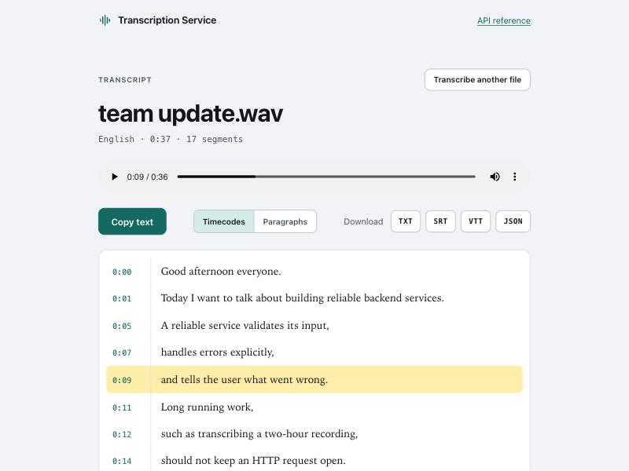
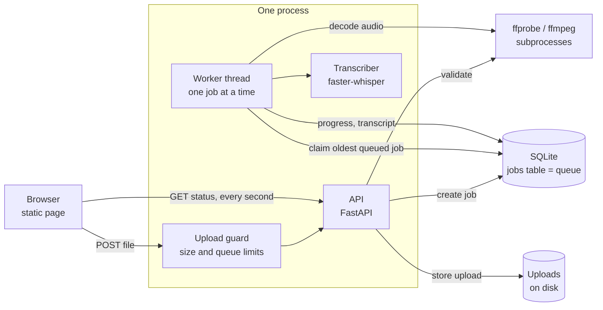

# Transcription Service

Upload an audio or video file in the browser and get a transcript with timestamps. Copy
it, or download it as plain text, SRT or WebVTT subtitles, or JSON.

The speech-to-text model is [Whisper](https://huggingface.co/Systran/faster-whisper-small),
an open-source model loaded from the Hugging Face Hub and run on CPU with
[faster-whisper](https://github.com/SYSTRAN/faster-whisper).



## Quick start with Docker

The only requirement is Docker with Compose.

```bash
docker compose up --build
```

Then open <http://localhost:8000>.

- The first build downloads the base image, ffmpeg, the Python dependencies and the model
  (about 0.5 GB), and takes a few minutes. Later starts take a few seconds.
- If port 8000 is taken, pick another one: `PORT=8080 docker compose up --build`.
- Stop with `docker compose down`. Add `-v` to also delete the stored transcripts.

To try it without a browser, upload the bundled 11-second sample and print its transcript:

```bash
./scripts/smoke_test.sh
```

## Running the tests

Inside Docker, with nothing else installed (lint, type check and the whole fast suite):

```bash
docker compose run --rm --build tests
```

Locally (needs Python 3.12 or newer, [uv](https://docs.astral.sh/uv/) and `ffmpeg`):

```bash
make install            # create .venv with the locked dependencies
make test               # 140 tests, a few seconds, no model needed
make lint               # ruff (lint and formatting) and mypy (types)
make test-integration   # the real model on the sample clip (downloads the model once)
```

The fast suite runs the whole application with a fake model, and generates its media
files (a tone, a video with and without sound, corrupt files) with ffmpeg as it runs.

## Running locally without Docker

```bash
make install
make run                # http://localhost:8000
```

The first start downloads the model into the Hugging Face cache. `make help` lists every
command.

## Using the API

Interactive documentation is served at <http://localhost:8000/docs>.

```bash
# 1. Upload. The answer comes back at once: 202 Accepted and a Location header.
curl -i -F "file=@tests/data/jfk.mp3" -F "language=en" http://localhost:8000/api/transcriptions

# 2. Poll the job until its status is "completed" (or "failed").
curl http://localhost:8000/api/transcriptions/<id>

# 3. Download the transcript: format is txt, srt, vtt or json.
curl -OJ "http://localhost:8000/api/transcriptions/<id>/download?format=srt"
```

| Method | Path | What it does | Success | Errors |
|---|---|---|---|---|
| `POST` | `/api/transcriptions` | Upload a file (`multipart/form-data`: `file`, optional `language`) | `202` + `Location` | `413`, `415`, `422`, `503` |
| `GET` | `/api/transcriptions/{id}` | Status, progress, queue position, and the transcript when ready | `200` | `404` |
| `GET` | `/api/transcriptions/{id}/download?format=` | The transcript as a file | `200` | `404`, `409`, `422` |
| `GET` | `/api/config` | The limits and options a client needs before uploading | `200` | |
| `GET` | `/health` | Whether the service can do its job | `200` | `503` |

Every error has the same JSON shape, with a stable `code` for programs and a `message`
for people:

```json
{"code": "unsupported_media_type", "message": "Unsupported file type .pdf. Supported types: ..."}
```

| Status | Code | Meaning |
|---|---|---|
| `404` | `job_not_found` | No transcription has this id |
| `409` | `job_not_ready` | The transcript was requested before the job completed |
| `413` | `file_too_large` | The upload is over `MAX_UPLOAD_MB` |
| `415` | `unsupported_media_type` | The file extension is not an accepted audio or video type |
| `422` | `unprocessable_media` | Not readable media, no audio track, or longer than the limit |
| `422` | `unsupported_language`, `invalid_request` | A bad `language` or a malformed request |
| `503` | `queue_full` | Too many jobs are waiting; comes with a `Retry-After` header |

## Architecture



What happens to an upload:

1. The **upload guard** refuses the request before its body is read if the queue is full
   or the declared size is over the limit, and stops a body that grows past the limit.
2. The **API** checks the extension, stores the file under a random job id, and runs
   `ffprobe` on it: it must be readable media with an audio track, within the duration
   limit. It then inserts a job row and answers `202`.
3. The **worker** claims the oldest queued job, decodes the audio track with `ffmpeg` to
   16 kHz mono samples, and hands them to the transcriber.
4. The **transcriber** works through the recording in 5-minute windows and reports
   progress, which the worker writes to the job row.
5. The transcript is saved, the uploaded file is deleted, and the page shows the result.

Each module in `app/` has one responsibility:

| Module | Responsibility |
|---|---|
| `main.py` | Application factory: the only place that knows all the parts |
| `config.py` | Settings from environment variables |
| `api.py`, `schemas.py` | HTTP endpoints and the JSON they return |
| `errors.py` | Error types and the common error format |
| `middleware.py` | Upload guard, response headers |
| `media.py` | Validation and decoding with ffprobe and ffmpeg |
| `store.py` | The jobs table in SQLite, which is also the queue |
| `worker.py` | The background worker thread |
| `transcriber.py`, `windows.py` | The `Transcriber` interface, its faster-whisper implementation, windowing |
| `formats.py` | TXT, SRT, WebVTT and JSON exports |
| `web.py`, `static/` | The page: plain HTML, CSS and JavaScript |

## Design decisions and trade-offs

### Uploads are accepted first and transcribed in the background

Transcription takes far longer than an HTTP request should stay open, so the upload
request only validates and stores the file and answers `202 Accepted`. The client polls
for the status. The job lives on the server: closing the tab does not cancel it, and the
job id in the page address (`#job=...`) brings the page back to it after a refresh.

Polling once a second is simple and enough here. WebSockets or Server-Sent Events would
push updates instead, at the cost of an open connection per waiting client.

### One worker thread, and the jobs table is the queue

A single background thread owns the model and transcribes one job at a time. One job
already uses several CPU cores, so running jobs side by side on one machine would only
split the same cores. The heavy work runs in native code (ffmpeg in a subprocess,
CTranslate2 for inference) that does not hold Python's GIL, so the API stays responsive
while a job is running.

There is no separate in-memory queue. The worker claims the oldest row with status
`queued` in a single `UPDATE ... RETURNING` statement, which has three consequences:

- a job can never be saved but not queued, because there is only one source of truth;
- the queue survives a restart without any recovery code;
- two workers could not claim the same job (a test runs 4 threads against 20 jobs).

After a crash, jobs left in `processing` go back to the queue. A job that was interrupted
twice is marked as failed instead, so a file that takes the service down cannot do it
forever. A clean shutdown puts the running job back without counting an attempt.

SQLite fits a service that runs on one machine: there is nothing to operate, the data is
on disk, and reads are fast. It stops fitting once several servers must share the state.

### Model: Whisper `small`, run by faster-whisper

Whisper is MIT-licensed, covers about 100 languages with one model, and returns
timestamps for each segment, which the subtitle exports need. faster-whisper runs the
same weights on CTranslate2 instead of PyTorch: the image stays small, and 8-bit
quantization (`int8`) makes CPU inference fast.

The default was chosen by measuring (Apple M4, CPU, `int8`, beam size 5):

| Model | Download | English WER | Hebrew WER | Speed |
|---|---|---|---|---|
| `Systran/faster-whisper-small` (default) | 0.5 GB | 4.1% | 42.5% | baseline |
| `mobiuslabsgmbh/faster-whisper-large-v3-turbo` | 1.6 GB | 2.8% | 33.2% | about 2.2 times slower |

- English: an 8-minute recording made of 78 consecutive LibriSpeech `test-clean`
  utterances by one reader. Hebrew: 12 clips from the FLEURS test set.
- WER (word error rate) after lower-casing and removing punctuation. The samples are
  small: they guided a choice and are not a benchmark claim.
- `uv run python scripts/benchmark.py [model]` repeats the English measurement through
  the service's own code path.

Inside the Docker container on the same machine (linux/arm64, 4 threads), the 8-minute
recording took about 2 minutes, so a half-hour recording takes roughly 8 minutes. The
container's memory peaked at 1.5 GB.

`small` is the default because the service is expected to run on a laptop CPU, where
turnaround time matters. The model is a build argument and a setting, so switching to the
more accurate model needs no code change. For Hebrew, a model fine-tuned on Hebrew
(`ivrit-ai/whisper-large-v3-turbo-ct2`, with the language set to `he`) is the better
choice; it was not benchmarked here.

**Batched decoding was measured and rejected as the default.** faster-whisper's
`BatchedInferencePipeline` was about twice as fast on the same recording with the same
error rate, but it returns 20 segments of about 24 seconds each, where sequential
decoding returns 127 segments of about 4 seconds. Subtitles need the short segments.
Asking the batched pipeline for timestamps brought the segments back, and raised the
error rate from 4.3% to 10%.

### Long recordings are transcribed in windows

A design review found that faster-whisper prepares the features of everything it is
given in one pass, which costs about 60 MB of memory per minute of audio. Measured: one
call needed an extra 0.5 GB for 8 minutes of speech and 1.7 GB for 32 minutes, so a
recording of a few hours would have exhausted the machine.

The transcriber therefore cuts the recording into 5-minute windows, each ending at the
quietest moment of its last 30 seconds, transcribes them one by one and shifts the
segment times. The language is detected on the first window that contains speech and
kept for the rest.

| | 8 minutes | 32 minutes | 2 hours |
|---|---|---|---|
| Extra memory, one call | 0.5 GB | 1.7 GB | not attempted |
| Extra memory, 5-minute windows | 0.4 GB | 0.4 GB | 0.4 GB |

Accuracy did not suffer: 3.9% WER with windows against 4.1% in a single call.

### Uploaded files are treated as hostile

- `ffprobe` and `ffmpeg` run as **subprocesses with timeouts**, so a file that crashes or
  hangs a decoder cannot take the service down.
- Both get **allow-lists for protocols and container formats**. This matters: a text
  file named `clip.mp3` containing an ffconcat script made `ffprobe` open another file
  on disk until the format allow-list was added. A test keeps it that way.
- The **duration limit does not trust the file**. A recording made in a browser declares
  no duration, and a crafted file with compressed timestamps declared 0.1 seconds while
  holding 10. Decoding is cut off by output size as well as by time, and the size is
  checked before the samples are loaded into memory.
- `ffprobe` accepts random bytes named `.aac` or `.flac` as audio. Streams without a
  sample rate or channels are rejected at upload time.
- The **original file name is never used as a path**. Files are stored under a random
  job id; the name is kept for display and for the download name only.
- Audio is decoded by the ffmpeg CLI and passed to the model as samples, not by the PyAV
  library inside the process. That keeps decoding isolated, and it avoids an
  incompatibility between faster-whisper 1.2.1 and PyAV 19 that breaks file decoding.

### Limits are enforced before the upload is read

FastAPI reads a multipart body and writes the file to a temporary file before the
endpoint runs, so a check inside the endpoint would come after a 2 GB upload had already
been received. A small ASGI middleware does the checks that only need the headers
(queue full, declared size) first, and counts the bytes of bodies that declare no size.

### The page

Plain HTML, CSS and JavaScript served by the app: no build step, no framework, and no
third-party requests (system fonts only).

- The page reads its limits from `GET /api/config`, so a file that is too large or of the
  wrong type is refused before it is uploaded, without duplicating the limits.
- Progress is shown as a timeline of the recording itself, with the position reached and
  an estimate of the time left.
- While the page that uploaded the file is still open, the browser plays the local file:
  a timecode in the transcript plays from that moment and the spoken line is
  highlighted. The server does not keep the media file for this.
- File names and transcript text are inserted with `textContent` only, and the page is
  served with a strict Content-Security-Policy.
- Right-to-left languages, keyboard use, dark mode and reduced motion are supported.

### Docker

- The **model is baked into the image**, so the service starts in seconds and works
  without network access. The alternative, downloading into a volume on first start,
  gives a smaller image and a slow, network-dependent first start.
- The service runs as a **non-root user**, with all capabilities dropped, and is
  published on `127.0.0.1` only because it has no authentication.
- ffmpeg comes from the Debian package, which adds about 420 MB to the image. A static
  build would be smaller; the package was chosen because it gets security updates with
  the base image.
- Dependencies are installed with `uv sync --frozen`, exactly as recorded in `uv.lock`.
- The container runs **one process**. The worker thread and the model live in it, so
  several server processes would each load a model and each start a worker.

## Configuration

Settings come from environment variables or a `.env` file (see
[.env.example](.env.example)); `docker compose` reads the same file. Invalid values stop
the service at startup.

| Variable | Default | Meaning |
|---|---|---|
| `WHISPER_MODEL` | `Systran/faster-whisper-small` | Model repository on the Hugging Face Hub, or a local path |
| `WHISPER_DEVICE` | `cpu` | `cpu` or `cuda` |
| `WHISPER_COMPUTE_TYPE` | `int8` | CTranslate2 quantization |
| `WHISPER_CPU_THREADS` | `0` | Threads for inference; `0` lets CTranslate2 choose (4) |
| `WHISPER_BEAM_SIZE` | `5` | Beam size for decoding |
| `MAX_UPLOAD_MB` | `2048` | Largest accepted upload |
| `MAX_DURATION_MINUTES` | `60` | Longest accepted recording |
| `MAX_PENDING_JOBS` | `10` | Jobs waiting or running before uploads get `503` |
| `MAX_JOB_ATTEMPTS` | `2` | Interrupted attempts before a job is marked failed |
| `DATA_DIR` | `data` (`/data` in Docker) | Job database and uploads in progress |
| `LOG_LEVEL` | `INFO` | `DEBUG`, `INFO`, `WARNING` or `ERROR` |
| `LOG_FORMAT` | `text` | `text`, or `json` for one object per line |

In Docker the model is part of the image, so change it at build time:
`docker compose build --build-arg WHISPER_MODEL=<repository>`.

## Assumptions

- A recording is up to about half an hour long, as confirmed for this assignment. The
  default limit is one hour, to leave a margin, and it is a setting. Because of the
  windowed transcription, raising it costs time and disk space, not memory.
- The service runs on one machine, on CPU.
- English is the main language. Other languages go through the same multilingual model
  with lower accuracy.
- There are no user accounts. A job id is a random UUID and acts as the key to its
  transcript, and there is no endpoint that lists jobs.
- Transcripts are kept until the data volume is deleted. Uploaded media is deleted as
  soon as its job finishes or fails.

## Limitations and next steps

- **One job at a time.** A long recording delays every job behind it. Next: a durable
  queue (Redis or SQS), workers deployed separately from the API on GPUs, a database
  server, and object storage for uploads. The 5-minute windows are already the unit that
  could be fanned out to several workers and stitched back by their time offsets.
- **CPU only.** A GPU is 10 to 50 times faster for this model. It needs
  `WHISPER_DEVICE=cuda`, `WHISPER_COMPUTE_TYPE=float16` and a CUDA base image.
- **A running job cannot be cancelled**, and there is no retention policy, authentication
  or rate limiting. Concurrent uploads are bounded only by the pending-jobs limit.
- **The upload is written twice**: the framework spools it to a temporary file, and it is
  then copied to the data directory. Uploading straight to object storage (presigned
  URLs) would remove both copies from the API.
- **Uploads could be much smaller.** The model needs only the audio track, which is
  about 2% of a typical video. Extracting it in the browser before uploading, or starting
  to transcribe while the upload is still arriving, would shorten the wait on slow
  networks.
- **Context does not carry across windows**, and the language is detected once, so a
  recording that switches language is transcribed as its first language.
- **No word-level timestamps or speaker labels.**
- **The page's JavaScript has no automated tests.** It was checked by hand in a browser.
- The decoded audio of a recording is held in memory (about 230 MB per hour).
